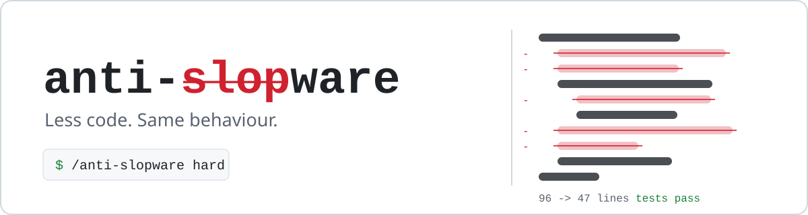

<div align="center">

<picture>
  <source media="(prefers-color-scheme: dark)" srcset="assets/banner-dark.svg">
  
</picture>

<br>

**Skills for AI coding agents that delete duplicated, useless and over-verbose code,<br>and prove nothing broke.**

[Install](#install) · [Use](#use) · [Levels](#levels) · [Proof](#proof) · [Roadmap](ROADMAP.md)

[](https://github.com/tarek-zy/anti-slopware/actions/workflows/verify.yml)
[](LICENSE)
[](https://agentskills.io)
[](#install)

</div>

---

AI agents write code fast, and a lot of it is filler: the same function twice, imports nobody uses, comments that repeat the line below them, five levels of nesting where one would do. A human still has to review all of it.

anti-slopware removes that filler. It runs your tests before and after, and reverts any change that breaks them.

## Before and after

One function from [`examples/python`](examples/python), cleaned with `/anti-slopware hard`:

<table>
<tr><th>Before</th><th>After</th></tr>
<tr>
<td>

```python
def get_discount(customer):
    if customer is not None:
        if "tier" in customer:
            if customer["tier"] == "gold":
                return 0.1
            else:
                if customer["tier"] == "silver":
                    return 0.05
                else:
                    return 0
        else:
            return 0
    else:
        return 0
```

</td>
<td>

```python
def get_discount(customer):
    if customer is None or "tier" not in customer:
        return 0
    if customer["tier"] == "gold":
        return 0.1
    if customer["tier"] == "silver":
        return 0.05
    return 0
```

</td>
</tr>
</table>

## Install

### Claude Code

```
/plugin marketplace add tarek-zy/anti-slopware
/plugin install anti-slopware@tarek-zy
```

Run it as `/anti-slopware:anti-slopware`.

### Any agent that reads SKILL.md

```
npx skills add tarek-zy/anti-slopware
```

Run it as `/anti-slopware`.

## Use

| Command | What it does |
|---|---|
| `/anti-slopware` | Clean the current changes at `medium` |
| `/anti-slopware easy` | Duplication only |
| `/anti-slopware hard src/parser.c` | Everything, one file |
| `/anti-slopware report` | List findings, change nothing |
| `/anti-slopware write hard` | Apply the rules to code about to be written |

Or ask in plain words: "clean up this branch", "remove the dead code in `utils/`".

## Levels

| Level | Removes | Applies |
|---|---|---|
| `easy` | Duplicated code | Directly |
| `medium` | + unused, unreachable and leftover code, comments that restate the code | After you approve the list |
| `hard` | + needless nesting, hand-written loops, single-use abstractions | After you approve the list |

Full definitions: [levels.md](skills/anti-slopware/references/levels.md).

## What it will not do

- Change behaviour: outputs, errors, ordering, numeric results.
- Remove or change anything public.
- Edit generated, vendored or ignored files, or anything outside the scope you gave.
- Make code shorter at the cost of clarity.
- Work without a safety net. With no tests covering the code, it reports and stops.
- Say your code is bug-free. It says what was checked and what was not.

## Proof

[`examples/python`](examples/python) holds one sloppy file and the result at each level. One test file runs against all four:

```
$ python3 examples/verify.py
before   96 lines  tests: pass
easy     86 lines  tests: pass
medium   56 lines  tests: pass
hard     47 lines  tests: pass
```

Two rewrites `hard` refused in that file, because they change results:

| Tempting rewrite | Why it was refused |
|---|---|
| `sum()` instead of the running total | On Python 3.12+, `sum([0.1] * 10)` is `1.0`. The loop gives `0.9999999999999999`. |
| A dictionary lookup for the discount tier | It raises on an unhashable tier where the original returned `0`. |

## Language checks

**C:** use-after-free, double free, leaks, overflows, unchecked allocations, format strings. It runs AddressSanitizer, Valgrind, clang-tidy and cppcheck when installed, and reports which ones ran. See [lang-c.md](skills/anti-slopware/references/lang-c.md) and [`examples/c`](examples/c).

## Skills

| Skill | Does | Status |
|---|---|---|
| `anti-slopware` | Duplicated, useless and verbose code | Shipped |
| `slim-pr` | Short, clear PR descriptions | Next |
| `test-slop` | Tests that prove nothing | Planned |
| `dep-check` | Unused and non-existent dependencies | Planned |
| `error-slop` | Swallowed and hidden errors | Planned |
| `junk-sweep` | Leftover screenshots, temp files, build caches | Planned |

More in [ROADMAP.md](ROADMAP.md). Contributions are welcome: see [CONTRIBUTING.md](CONTRIBUTING.md).

## Related

For generic-looking UI and copy, see [antislop](https://github.com/miqdadbadjuber/anti-slop). This project covers code and review.

---

<div align="center">

*The best code review is the one with less to read.*

[MIT](LICENSE)

</div>
