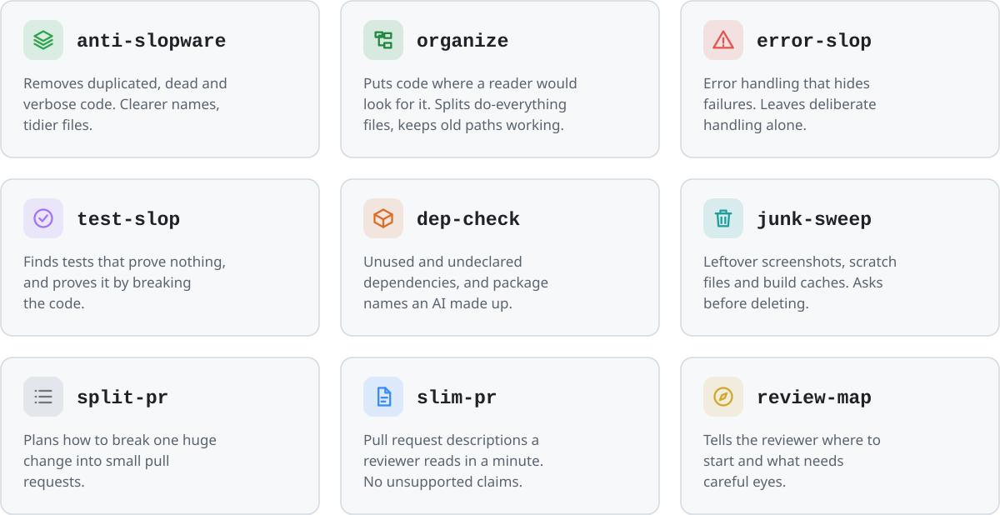
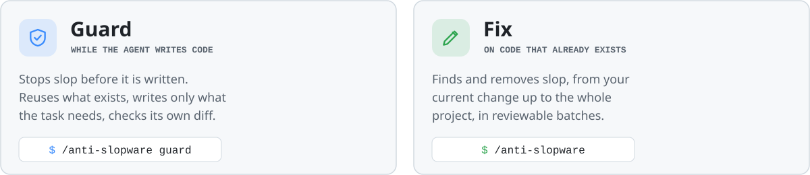
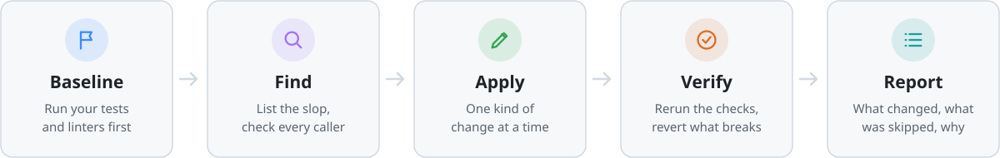
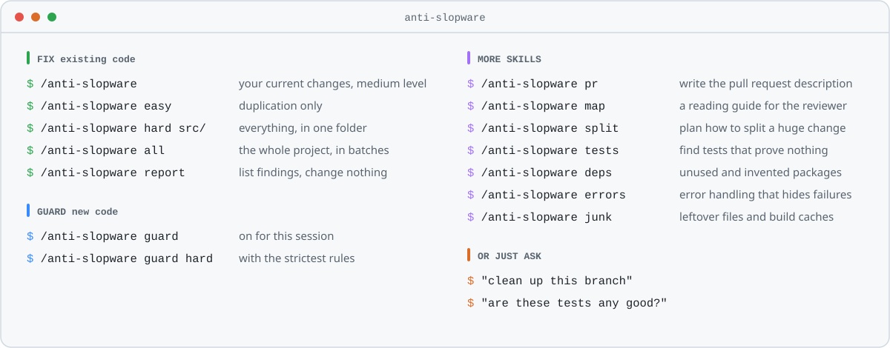
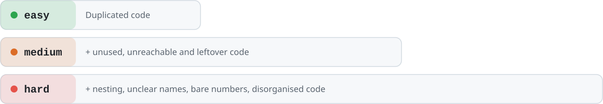
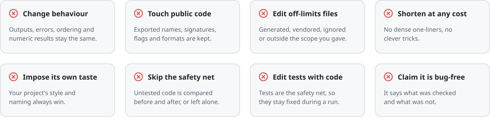
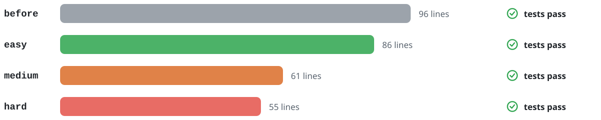
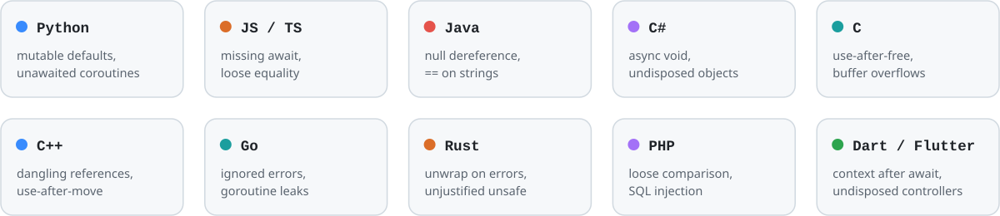
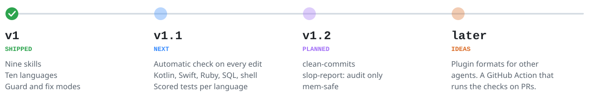

<div align="center">

<picture>
  <source media="(prefers-color-scheme: dark)" srcset="assets/banner-dark.svg">
  
</picture>

<br>

**A plugin that quietly raises the quality of the code your AI agent writes:<br>cleaner, better organised and documented, so the project stays easy to maintain and to improve.**

[Skills](#what-is-inside) · [Two modes](#two-modes) · [How it works](#how-it-works) · [Install](#install) · [Use](#use) · [Levels](#levels) · [Proof](#proof) · [Roadmap](#roadmap)

[](https://github.com/tarek-zy/anti-slopware/actions/workflows/verify.yml)
[](LICENSE)
[](https://agentskills.io)
[](#install)

</div>

---

AI agents write code fast, and a lot of it is filler: the same function twice, imports nobody uses, comments that repeat the line below them, five levels of nesting where one would do. Every later change, by a person or by an agent, has to work around it.

anti-slopware improves the quality of that code, so the next fix or feature is easier to make. It removes the filler, then makes what is left clearer and better organised. It runs your tests before and after, and reverts any change that breaks them.

## What is inside

<p align="center"></p>

## What it improves

| Goal | What changes |
|---|---|
| **Easier to change** | One copy of each rule, no dead code to step around, functions that do one job |
| **Easier to understand** | Flat control flow instead of deep nesting, names that say what a thing holds, named constants instead of bare numbers |
| **Better documented** | A file map, pages for the logic that is not obvious, docstrings in your project's style, comments that are short and correct |
| **Less clutter on disk** | Throwaway logs, caches and leftovers removed after you approve; backups, application and audit logs, secrets and data never touched |
| **Better organised** | Related code kept together, one pattern per job, files that each do one thing, no `utils` dumping grounds, no circular dependencies |

### Structure

The `organize` skill works on how the project is laid out. It splits files that do several unrelated jobs, moves code to where a reader would look for it, breaks up `utils` files that have collected everything, removes circular dependencies and deletes stale duplicate modules.

It plans first and shows you the list. Then it makes one move at a time, changes nothing inside the moved code, and leaves every old import path working, so your tests pass unchanged. It follows the structure your project already has and never invents a new architecture.

### Documentation

The `code-docs` skill documents the code so that people and coding agents can find their way around it. It works in layers: a file map, how the parts fit together, the logic that is not obvious from the code, reference docstrings, and comments.

- **It learns your project's documentation system first** and extends it: your docs folder, your docs tool and its navigation, your docstring style, your decision records. It never drops in a template of its own.
- **It never loses information.** A long comment block moves into a doc page, and a short comment stays in the code pointing to it.
- **It corrects what is wrong.** A comment or page that disagrees with the code is fixed, or raised as a question when it is unclear which is right.
- **It never invents a reason.** If nobody wrote down why something is the way it is, it asks you.
- **It changes no code.** Only comments, docstrings and documentation files.

The other skills work with it: cleanup leaves comments alone, guard mode documents new code as it is written, and `organize` is followed by an update to the file map.

This is not a minifier. Fewer lines is a side effect, not the goal. When a named constant or a small helper makes code clearer, it adds one, and it never trades clarity for brevity.

## Two modes

<p align="center"></p>

Use one or both. Guard keeps new code clean. Fix deals with what is already there.

## How it works

<p align="center"></p>

Nothing is changed before your tests and linters have run once, and nothing stays changed if they fail afterwards.

## Changes small enough to check

AI can write code faster than anyone can check it. When checking turns into skimming, quality slips without anyone deciding it should. Every part of this plugin keeps a change small and explained, so whoever owns the project can tell what changed and that nothing else did.

- **Small scope.** By default it touches only your current change, not the whole repo.
- **One kind of change at a time.** Duplicate removal, dead code and renames arrive separately, so you can accept one and reject another.
- **Renames and moves on their own.** They never hide inside other edits.
- **A short report.** What changed and why, what was skipped, which checks ran, and what nothing verified.
- **Batches you can check.** A whole-project cleanup goes folder by folder and stops to ask when a batch gets large.
- **Tests left alone.** It does not edit tests in the same run as the code they protect.

The `slim-pr` skill then writes the pull request description: what changed, why, how to test it and the risks, in 200 words or fewer. It drops claims the diff does not support, never trims a breaking change, and lists stray files and unrelated edits that should not be in the branch.

The `review-map` skill writes a reading guide for the reviewer: which files to read first and in what order, one question to ask of each, what is mechanical and can be skimmed, and the three riskiest spots. It points; it never says the change is good.

The `split-pr` skill plans how to break one oversized branch into small pull requests: one purpose each, mechanical changes first, tests kept with the code they test, and a list of what should be dropped. It writes the plan and leaves the branch alone.

## Before and after

One function from [`examples/python`](examples/python), cleaned with `/anti-slopware hard`:

<table>
<tr><th>Before</th><th>After</th></tr>
<tr>
<td>

```python
def get_discount(customer):
    if customer is not None:
        if "tier" in customer:
            if customer["tier"] == "gold":
                return 0.1
            else:
                if customer["tier"] == "silver":
                    return 0.05
                else:
                    return 0
        else:
            return 0
    else:
        return 0
```

</td>
<td>

```python
def get_discount(customer):
    if customer is None or "tier" not in customer:
        return 0
    if customer["tier"] == "gold":
        return 0.1
    if customer["tier"] == "silver":
        return 0.05
    return 0
```

Same result for every input. No nesting to keep in your head.

</td>
</tr>
</table>

## Install

### Claude Code

```
/plugin marketplace add tarek-zy/anti-slopware
/plugin install anti-slopware@tarek-zy
```

Run it as `/anti-slopware:anti-slopware`.

### Any agent that reads SKILL.md

```
npx skills add tarek-zy/anti-slopware
```

Run it as `/anti-slopware`.

## Use

<p align="center"></p>

<details>
<summary>All commands as text, to copy</summary>

| Command | What it does |
|---|---|
| `/anti-slopware` | Fix the current changes at `medium` |
| `/anti-slopware easy` | Duplication only |
| `/anti-slopware hard src/parser.c` | Everything, including naming and organisation, one file |
| `/anti-slopware all` | Fix the whole project, one folder at a time |
| `/anti-slopware report` | List findings, change nothing |
| `/anti-slopware docs` or `/code-docs` | Audit the documentation; add `write` to fix and extend it |
| `/anti-slopware organize` or `/organize` | Plan a better file and module structure; add `apply` to carry it out one move at a time |
| `/anti-slopware pr` or `/slim-pr` | Write or trim the pull request description |
| `/anti-slopware split` or `/split-pr` | Plan how to break one oversized branch into small pull requests |
| `/anti-slopware map` or `/review-map` | A reading guide for the reviewer: where to start, what needs careful eyes, what to skim |
| `/anti-slopware junk` or `/junk-sweep` | List leftover files and caches with sizes; add `clean` to remove them after approval |
| `/anti-slopware errors` or `/error-slop` | Report error handling that hides failures; add `fix` to change it |
| `/anti-slopware deps` or `/dep-check` | Report unused, missing and unverifiable dependencies; add `fix` to edit the manifest |
| `/anti-slopware tests` or `/test-slop` | Report tests that prove nothing; add `fix` to strengthen or remove them |
| `/anti-slopware guard` | Turn guard mode on for this session |
| `/anti-slopware guard hard` | Guard mode with the strictest rules |

</details>

Or ask in plain words: "clean up this branch", "remove the dead code in `utils/`".

## Levels

<p align="center"></p>

| Level | Fixes | Applies |
|---|---|---|
| `easy` | Duplicated code | Directly |
| `medium` | + unused, unreachable and leftover code | After you approve the list |
| `hard` | + needless nesting and single-use abstractions, misleading names, unnamed constants, functions that do several jobs, scattered related code | After you approve the list |

Full definitions: [levels.md](skills/anti-slopware/references/levels.md).

## What it will not do

<p align="center"></p>

<details>
<summary>The same list as text</summary>

- Change behaviour: outputs, errors, ordering, numeric results.
- Remove or change anything public.
- Edit generated, vendored or ignored files, or anything outside the scope you gave.
- Delete your comments. Comments are documentation. They are organised and corrected, never stripped.
- Make code shorter at the cost of clarity.
- Rename or reorganise to suit its own taste. Your project's style wins.
- Work without a safety net. Code with no tests is compared before and after, and listed as not verified by tests. Code it cannot exercise is reported, not changed.
- Edit your tests while it edits the code they protect.
- Say your code is bug-free. It says what was checked and what was not.

</details>

## Proof

[`examples/python`](examples/python) holds one sloppy file and the result at each level. One test file runs against all four:

<p align="center"></p>

Run it yourself: `python3 examples/verify.py`

`hard` is not the shortest possible version. It added a named constant, `BULK_ORDER_MIN_UNITS`, in place of a bare `10`, because that reads better, and it kept every comment.

Two rewrites `hard` refused in that file, because they change results:

| Tempting rewrite | Why it was refused |
|---|---|
| `sum()` instead of the running total | On Python 3.12+, `sum([0.1] * 10)` is `1.0`. The loop gives `0.9999999999999999`. |
| A dictionary lookup for the discount tier | It raises on an unhashable tier where the original returned `0`. |

## Language checks

Cleanup is one job. Finding bugs is another. For each language in your code, the skill first checks that the code builds, runs the standard tools that are installed, then reads for the bugs that language is known for. It reports them as findings and fixes them only if you ask, because a fix changes behaviour.

<p align="center"></p>

<details>
<summary>Tools it runs and what it looks for, per language</summary>

| Language | Tools it runs when installed | Examples of what it looks for |
|---|---|---|
| Python | compileall, Ruff, mypy or Pyright, Vulture, Bandit | Mutable default arguments, unawaited coroutines, broad `except`, unsafe `eval` and `pickle` |
| JavaScript, TypeScript | `node --check`, `tsc`, ESLint, Knip | Missing `await`, loose equality, stale closures in hooks, `any` and `!` hiding errors |
| Java | javac, SpotBugs, Error Prone, PMD | Null dereference, `==` on strings, unclosed resources, thread-unsafe shared state |
| C# | `dotnet build` analyzers, `dotnet format` | `async void`, blocking on `.Result`, undisposed objects, LINQ enumerated twice |
| C | compiler warnings, AddressSanitizer, Valgrind, clang-tidy, cppcheck | Use-after-free, double free, leaks, buffer overflows |
| C++ | sanitizers, clang-tidy, cppcheck | Dangling references, iterator invalidation, use-after-move, slicing |
| Go | `go vet`, race detector, Staticcheck, govulncheck | Ignored errors, shadowed `err`, goroutine leaks, data races |
| Rust | `cargo check`, Clippy, Miri, cargo audit | `unwrap` on recoverable errors, unjustified `unsafe`, locks held across `.await` |
| PHP | `php -l`, PHPStan, Psalm | Loose comparison, SQL injection, unescaped output |
| Dart, Flutter | `dart analyze`, `flutter test` | `BuildContext` after `await`, undisposed controllers, futures created in `build` |
| Shell | `bash -n` or `sh -n`, ShellCheck, checkbashisms | Unquoted expansions, Bash syntax under `sh`, failures a pipeline hides, `eval` on input |

</details>

Every language also gets the checks for mistakes AI-written code makes everywhere: invented APIs, wrong signatures, swallowed errors, off-by-one, leaked resources, injection and secrets in code.

Each language file also lists what is **not** slop there, such as functions a framework finds by name, so cleanup leaves them alone. Details: [languages.md](skills/anti-slopware/references/languages.md).

It reports which tools ran and which were missing, and it never claims your code is bug-free.

## Roadmap

<p align="center"></p>

Details in [ROADMAP.md](ROADMAP.md). Contributions are welcome: see [CONTRIBUTING.md](CONTRIBUTING.md). Adding a language check is a good first one.

## Related

For generic-looking UI and copy, see [antislop](https://github.com/miqdadbadjuber/anti-slop). This project covers code and review.

---

<div align="center">

*Good code makes the next change easy.*

[MIT](LICENSE)

</div>
